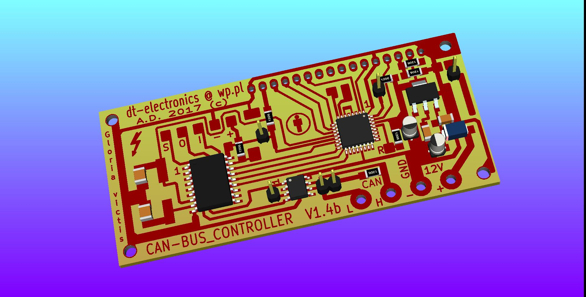
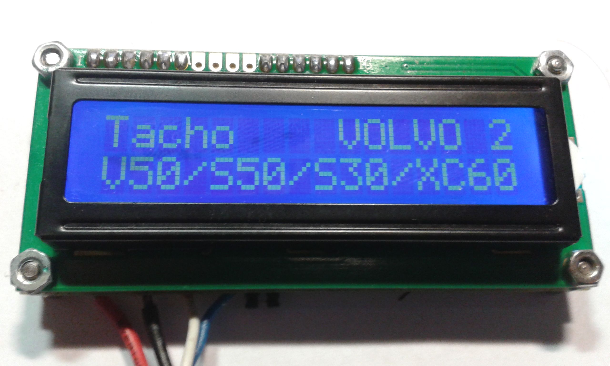
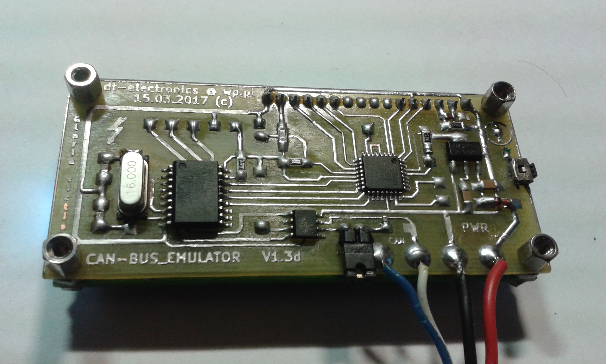
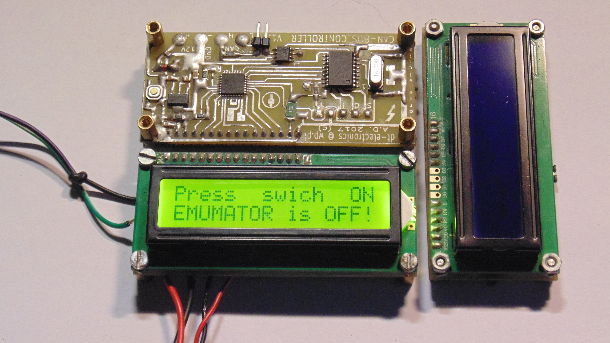

# LCD CAN-BUS EMULATOR By Daniel SP6QKX 

Helpful when Power-UP and test devices controlled by CAN-BUS
 
Project its under construction ! 

More information on email  s p 6 q k x @ p o c z t a . f m

https://qrz.com/DB/SP6QKX

https://www.facebook.com/sp6qkx

https://www.winsell.pl

https://www.sp6qkx.winsell.pl

That all folks :) 

Thanks and Greetings 

vy73 Daniel SP6QKX )

https://youtu.be/tvbWc_svBSQ

